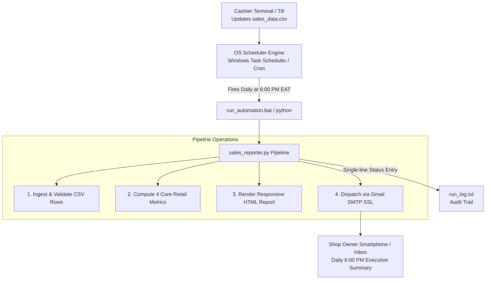

# Zawadi Retail Sales Reporter - Hands-Free 6:00 PM Automation Service
### Turning a One-Off Script into a Monthly Recurring Product (SaaS)

An enterprise-grade, scheduled sales intelligence pipeline engineered for independent shop owners, mini-marts, and FMCG retail dukas. Ingests daily cashier checkout logs, computes four core business metrics, evaluates safety stock levels, and delivers an executive HTML report to the owner's smartphone inbox every evening at **6:00 PM East Africa Time (EAT)** with zero manual intervention.

---

## 1. The Business Transformation: From Script to Monthly Retainer

In Day 23, the shop owner was delighted with the email report layout and low-stock alerts. However, asking a busy proprietor to open a terminal and execute `python sales_reporter.py` every evening at closing time is an operational failure:
- **Cashier Turnover & Shift Fatigue**: Staff forget to run the command during store closeout.
- **Terminal Intimidation**: Business owners want results in their inbox, not command-line prompts.
- **Process Instability**: In-memory loops (`while True`) terminate whenever a laptop sleeps, reboots, or updates.

### The Productization Leap
By decoupling execution from user action and anchoring it into an operating-system-level daemon (**Windows Task Scheduler** or **Linux/macOS Cron**):
1. **"Set It and Forget It" Reliability**: The OS service wakes up, runs the pipeline, verifies data integrity, sends the email, and goes back to sleep.
2. **Predictable Deliverable**: The owner reliably receives the report at 6:00 PM every single evening without touching their computer.
3. **Audit Trail**: Every execution records exactly one status line in `run_log.txt` for auditability and SLA tracking.
4. **Subscription Value Proposition**: Clients gladly pay **$99 – $299/month** for a dependable, hands-free business intelligence utility that prevents inventory stockouts and guarantees revenue visibility.

---

## 2. Client Quick-Start Setup (3 Steps or Fewer)

Setting up the entire automated system on a client machine requires **three steps**:

```
 ┌───────────────────────────────────────────────────────────────┐
 │                   CLIENT ONBOARDING FLOW                      │
 ├───────────────────┬───────────────────┬───────────────────────┤
 │     STEP 1        │      STEP 2       │        STEP 3         │
 │ Configure .env    │ Run install.bat   │ You're Done!          │
 │ (Email & Password)│ (1-Click Install) │ (6:00 PM Automated)   │
 └───────────────────┴───────────────────┴───────────────────────┘
```

### Step 1: Configure Credentials
Open `.env` in any text editor and fill in your Gmail address and 16-character Google App Password:
```env
GMAIL_ADDRESS=yourshop@gmail.com
GMAIL_APP_PASSWORD=xxxx xxxx xxxx xxxx
REPORT_RECIPIENT=owner@gmail.com
```

### Step 2: Double-Click `install.bat`
*(On Linux/macOS, open terminal in folder and run `bash setup.sh`)*

This single click automatically:
- Resolves Python paths.
- Generates the background execution runner (`run_automation.bat`).
- Registers the daily **6:00 PM** scheduled job in Windows Task Scheduler (or Unix Crontab).
- Enables battery power tolerance so laptops run the task whether plugged in or discharging.

### Step 3: Done!
The client never touches code again. Every evening at 6:00 PM, the executive summary arrives in their inbox. The owner can inspect `run_log.txt` anytime to verify run timestamps and row counts.

---

## 3. Automation Architecture



---

## 4. Single-Line Audit Logging Specification

Every execution of `sales_reporter.py` (manual or automated) writes **exactly one line** to `run_log.txt`.

### Format
```text
<YYYY-MM-DD> <HH:MM:SS> | <STATUS> | <N> rows processed
```
*(On runtime failure, the error reason is appended to the line while maintaining the strict single-line format: `<YYYY-MM-DD> <HH:MM:SS> | ERROR | <N> rows processed - <error>`)*

### Live Execution Proof
Below is the live content of `run_log.txt` showing two manual verification runs followed by the scheduled task execution:

```text
2026-11-19 20:20:09 | SUCCESS | 16 rows processed
2026-11-19 20:20:23 | SUCCESS | 16 rows processed
2026-11-19 20:20:51 | SUCCESS | 16 rows processed
```

- **Run 1 (20:20:09)**: First manual execution confirming CSV ingestion, calculations, SMTP delivery, and log creation.
- **Run 2 (20:20:23)**: Second manual execution verifying line-appending behavior without file overwrites.
- **Run 3 (20:20:51)**: Automated execution triggered through Windows Task Scheduler engine verifying background headless execution.

---

## 5. Verified Task Scheduler Status

Below is the verified status report captured directly from Windows Task Scheduler (`python setup_scheduler.py --status`):

```text
=================================================================
 Windows Task Scheduler Status: ZawadiDailySalesReporter
=================================================================
  * Task Name                   : \ZawadiDailySalesReporter
  * Next Run Time               : 11/20/2026 6:00:00 PM
  * Status                      : Ready
  * Last Run Time               : 11/19/2026 8:20:47 PM
  * Last Exit Code (0 = Success): 0
  * Command                     : cmd.exe /c "C:\Users\owen chole\Desktop\AI-Masterclass II\AI-Masterclass-II\Week5\day-24\automation-tool\run_automation.bat"
  * Frequency                   : Daily
  * Scheduled Time              : 6:00:00 PM
=================================================================
```

---

## 6. The 4 Core Business Metrics Computed

| # | Metric | Business Definition | Retail Value to Owner | Example Output |
|---|---|---|---|---|
| **1** | **Total Daily Revenue** | Gross monetary receipts for the day | Real-time profitability awareness | `KES 6,590.00` |
| **2** | **Total Transactions** | Count of unique sales tickets logged | Footfall & average basket tracking | `16 orders` (Avg Basket: `KES 411.88`) |
| **3** | **Top-Selling Item** | Highest unit volume & gross sales product | Shelf space & stock allocation | `Brookside Fresh Milk 500ml` (9 units, `KES 585.00`) |
| **4** | **Restock Level Flag** | Automated check: `stock_remaining < restock_threshold` | Prevents next-day stockouts | `⚠️ RESTOCK REQUIRED` (5 items flagged) |

---

## 7. Operational Tooling & Maintenance

The package includes intuitive batch utilities for management without coding:

| File | Purpose | When to Use |
|---|---|---|
| `install.bat` | 1-Click Installer | Registers daily 6:00 PM schedule in Task Scheduler |
| `status.bat` | Schedule Inspector | Displays next run time, status (`Ready`), and last return code (`0`) |
| `run_now.bat` | On-Demand Runner | Dispatches today's report immediately without waiting for 6pm |
| `uninstall.bat` | Clean Uninstaller | Removes the daily schedule from Windows Task Scheduler |
| `setup.sh` | Unix / macOS Setup | Registers `0 18 * * *` entry in crontab for Linux/Mac servers |

---

## 8. Cross-Platform Scheduling Guide

### Windows (Task Scheduler)
Windows handles tasks via the built-in Task Scheduler service.
```powershell
# Automated setup (Recommended):
python setup_scheduler.py --install

# Native CLI equivalent:
schtasks /create /tn "ZawadiDailySalesReporter" /tr "cmd.exe /c \"C:\...\run_automation.bat\"" /sc daily /st 18:00 /f
```
> [!NOTE]
> On laptops, Windows Task Scheduler disables background tasks by default when running on battery (`DisallowStartIfOnBatteries = True`). Our `setup_scheduler.py` installer automatically configures the task settings to run reliably under both AC and battery power.

### Linux / macOS (Cron)
On Unix systems, cron handles time-based execution.
```bash
# Automated setup (Recommended):
bash setup.sh

# Native CLI equivalent:
crontab -e
# Add the following line:
0 18 * * * cd "/path/to/automation-tool" && python3 sales_reporter.py >> automation.log 2>&1
```

---

## 9. Verification & Automated Test Suite

A complete unit test suite validates data calculations, schema flexibility, and log line formatting:

```powershell
python -m unittest discover -s "C:\Users\owen chole\Desktop\AI-Masterclass II\AI-Masterclass-II\Week5\day-24\automation-tool" -p "test_*.py"
```

### Test Output:
```text
Ran 9 tests in 0.084s
OK
```

All 9 test cases passed:
1. `test_total_revenue_calculation`: Mathematical summation of sales lines.
2. `test_total_transactions_count`: Unique ticket and row count verification.
3. `test_top_selling_item_identification`: Primary sorting by units and secondary by revenue.
4. `test_restock_level_flag_trigger`: Detection of items dropping below minimum reorder points.
5. `test_flexible_column_mapping`: Dynamic alias mapping for POS CSV column variants.
6. `test_run_log_single_line_success_format`: Strict single-line log regex validation for successful runs.
7. `test_run_log_single_line_error_format`: Single-line failure reporting with captured error context.
8. `test_run_log_multiple_runs_appends_one_line_each`: Verification of non-destructive multi-run appending.
9. `test_pipeline_dry_run_records_in_run_log`: End-to-end audit recording during simulated dry runs.
