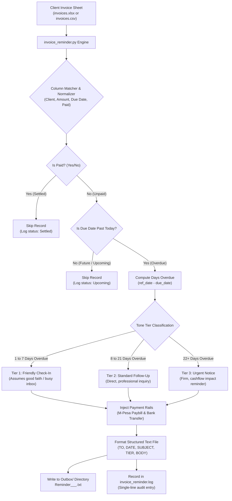

# Automated Invoice Reminder Script
### Cashflow Protection Pipeline for Freelancers & Kenyan Small Businesses (SMEs)

A robust, production-ready Python automation tool engineered for independent professionals, boutique agencies, consultants, and SME owners who lose hours every month tracking down accounts receivable. Ingests an Excel or CSV invoice register, evaluates payment statuses and maturity dates, dynamically generates culturally polite and escalating follow-up email drafts based on days overdue, and outputs ready-to-dispatch `.txt` files directly into an `Outbox/` folder.

---

## 1. The Business Problem: Cashflow & The "Awkward Email" Dilemma

For solo freelancers and small business proprietors across Kenya and East Africa:
- **Cash Flow Bottlenecks**: Over 60% of SMEs and independent service providers experience late payments (15–60 days past invoice due dates), disrupting rent, payroll, and personal commitments.
- **The "Awkward" Follow-Up Friction**: Freelancers delay chasing invoices because they fear sounding aggressive, ungrateful, or alienating a valued client.
- **Manual Spreadsheet Fatigue**: Manually scanning rows, calculating dates on calendars, drafting individual emails, and pasting bank or M-Pesa details consumes **5 to 10 hours every month**.

### The Solution: Automated, Tiered Follow-Ups
This tool decouples emotion from receivables:
1. **Objective Date Calculation**: Compares invoice due dates against the calendar automatically.
2. **Polite Escalation Tiers**: Chooses an appropriately calibrated tone—from a warm, courteous check-in for fresh invoices (1–7 days late) to an urgent yet respectful final notice for aging invoices (22+ days late).
3. **Turnkey M-Pesa & Bank Details**: Embeds verified Kenyan payment rails (Paybill, Account, Bank Transfer) into every draft.
4. **Offline Safety**: Saves generated emails as structured `.txt` files in `Outbox/` so the business owner retains final review authority before sending.

---

## 2. Client Persona & Commercial Pricing Strategy

### Target Client Persona
- **Creative & Digital Freelancers**: Graphic designers, web developers, copywriters, videographers, SEO specialists.
- **Boutique Agencies**: PR firms, social media agencies, digital marketing shops in Nairobi, Mombasa, and Kisumu.
- **Professional Service Providers**: Independent accountants, legal researchers, HR recruiters, corporate trainers.
- **Local Service SMEs**: Cleaning agencies, catering businesses, equipment leasing, courier and logistics providers.

### Market Pricing & Value Proposition

| Offering Tier | Deliverable | Client Price (KES) |
|---|---|---|
| **Standard Setup** | Initial script installation, customized email templates, `.env` setup with client's M-Pesa Paybill / Bank details, spreadsheet template integration, and 1-click desktop batch runner. | **KES 8,000 – 12,000** (one-off) |
| **Turnkey SME Package** | Standard setup + automated daily/weekly OS schedule (Windows Task Scheduler / Cron), multi-tier tone escalation, customized company letterhead, staff training. | **KES 12,000 – 15,000** (one-off) |
| **Monthly Retainer (Optional)** | Monthly template updates, backup maintenance, and log monitoring. | **KES 3,000 – 5,000 / month** |

> [!TIP]
> **ROI Justification for the Client**: Chasing a single unpaid invoice of KES 45,000 that would have otherwise lingered for months pays for this entire automation setup 3× to 5× over on day one.

---

## 3. Automation Architecture



---

## 4. Tone Escalation Matrix

The engine dynamically adjusts tone and subject lines based on how many days have elapsed past the due date:

| Tier | Overdue Window | Classification | Subject Line Example | Communication Style |
|:---:|:---:|---|---|---|
| **Tier 1** | **1 – 7 days** | Friendly Check-in | `Gentle Reminder: Invoice INV-1002 (Baraka Logistics) - Simiyu Agency` | Courteous and conversational. Assumes good faith, acknowledges busy schedules, and asks if payment is already in transit. |
| **Tier 2** | **8 – 21 days** | Standard Follow-Up | `Follow-Up: Outstanding Invoice INV-1001 (Amani Media) - Simiyu Agency` | Clear, direct, and professional. Inquires about disbursement dates and requests confirmation references (M-Pesa code / slip). |
| **Tier 3** | **22+ days** | Urgent Notice | `Important Notice: Overdue Invoice INV-1004 (Safari Haven) - Simiyu Agency` | Firm, serious, yet polite. Highlights the impact of late receivables on small business operations and requests settlement within 48–72 hours. |

---

## 5. Client Quick-Start Guide (3 Steps)

```
 ┌───────────────────────────────────────────────────────────────┐
 │                   CLIENT ONBOARDING FLOW                      │
 ├───────────────────┬───────────────────┬───────────────────────┤
 │     STEP 1        │      STEP 2       │        STEP 3         │
 │ Update Excel File │ Configure .env    │ Double-Click Runner   │
 │ (invoices.xlsx)   │ (Payment Details) │ (run_reminder.bat)    │
 └───────────────────┴───────────────────┴───────────────────────┘
```

### Step 1: Provide Your Invoices
Place your spreadsheet named `invoices.xlsx` (or `invoices.csv`) in the folder. It must contain the four core columns:
1. `client name`
2. `invoice amount`
3. `due date`
4. `paid (yes/no)`

*(Optional helper columns like `invoice number`, `client email`, and `service description` are automatically detected if present).*

### Step 2: Configure Business & Payment Details
Open `.env` in any text editor and personalize your details:
```env
BUSINESS_NAME=Simiyu Creative Agency
SENDER_NAME=Branham Simiyu
SENDER_EMAIL=billing@simiyucreative.co.ke
SENDER_PHONE=+254 712 345 678

# Payment Rails
MPESA_PAYBILL=247247
MPESA_ACCOUNT=[InvoiceID] (or Client Name)
BANK_NAME=Equity Bank Kenya
BANK_ACCOUNT_NAME=Simiyu Creative Agency
BANK_ACCOUNT_NUMBER=0110192837465
BANK_BRANCH=Westlands Branch, Nairobi
```

### Step 3: Run the Automation
On Windows, double-click **`run_reminder.bat`** *(or run `python invoice_reminder.py`)*.

The tool displays an executive summary table and writes all drafted emails directly into the **`Outbox/`** directory.

---

## 6. Live Execution Proof & Outbox Verification

Running `python invoice_reminder.py` on the included sample invoice register produces:

```text
==============================================================================
  INVOICE REMINDER AUTOMATION SERVICE  --  21 November 2026
==============================================================================
  Total Invoices Scanned : 8
  - Settled / Paid       : 2
  - Upcoming / Current   : 2
  - Overdue (Unpaid)     : 4
  Total Overdue Balance  : KES 183,500.00
  Outbox Folder          : ...\Week5\day-25\invoice-reminder\Outbox
------------------------------------------------------------------------------

[+] DRAFTED EMAIL REMINDERS (SAVED TO OUTBOX):
Client Name              Invoice #    Amount (KES)  Days Late Tone Tier       
------------------------------------------------------------------------------
Amani Creative Media     INV-1001        45,000.00      +12 d Tier 2 (Standard Follow-Up)
    --> File: Reminder_Amani_Creative_Media_INV-1001_20261121.txt
Baraka Logistics Ltd     INV-1002        18,500.00       +3 d Tier 1 (Friendly Check-in)
    --> File: Reminder_Baraka_Logistics_Ltd_INV-1002_20261121.txt
Safari Haven Tours       INV-1004        92,000.00      +35 d Tier 3 (Urgent Notice)
    --> File: Reminder_Safari_Haven_Tours_INV-1004_20261121.txt
Zawadi Retail Grocers    INV-1006        28,000.00       +9 d Tier 2 (Standard Follow-Up)
    --> File: Reminder_Zawadi_Retail_Grocers_INV-1006_20261121.txt
------------------------------------------------------------------------------

[-] SKIPPED INVOICES (UP TO DATE OR NOT OVERDUE):
  * Nairobi Tech Hub (INV-1003) - KES 65,000.00 | Status: Not overdue (Due in 7 days)
  * Kilifi Coconut Ventures (INV-1005) - KES 14,000.00 | Status: Paid (Settled)
  * Mama Mboga Fresh Supply (INV-1007) - KES 12,500.00 | Status: Paid (Settled)
  * Eldoret Grain Millers (INV-1008) - KES 35,000.00 | Status: Not overdue (Due in 14 days)
==============================================================================
```

### Example Generated Outbox File (`Outbox/Reminder_Baraka_Logistics_Ltd_INV-1002_20261121.txt`)
```text
TO: Baraka Logistics Ltd <finance@barakalogistics.com>
DATE: 21 November 2026
SUBJECT: Gentle Reminder: Invoice INV-1002 (Baraka Logistics Ltd) - Simiyu Creative Agency
TIER: Tier 1 (Friendly Check-in - 3 days overdue)
INVOICE AMOUNT: KES 18,500.00
DUE DATE: 18 November 2026
================================================================================

Dear Baraka Logistics Ltd,

I hope you are having a productive and pleasant week.

This is a friendly reminder that invoice INV-1002 for KES 18,500.00 (regarding: Fleet GPS Tracking Integration) was due on 18 November 2026 (3 days ago).

We know how quickly time flies and how busy schedules get, so we wanted to gently bring this to your attention in case it slipped past your inbox. If payment has already been initiated, please disregard this note with our warmest thanks.

PAYMENT DETAILS:
--------------------------------------------------------------------------------
1. M-PESA PAYBILL
   - Business Number: 247247
   - Account Number : INV-1002 (or Client Name)

2. BANK TRANSFER
   - Bank Name      : Equity Bank Kenya
   - Account Name   : Simiyu Creative Agency
   - Account Number : 0110192837465
   - Branch         : Westlands Branch, Nairobi
--------------------------------------------------------------------------------

If you need another copy of the original invoice or have any questions regarding the deliverables, please reply directly or reach me via WhatsApp/phone at +254 712 345 678.

Thank you for your valued partnership!

Warm regards,

Branham Simiyu
Lead Consultant / Finance
Simiyu Creative Agency
Phone: +254 712 345 678
Email: billing@simiyucreative.co.ke
```

---

## 7. Spreadsheet Column Mapping Flexibility

The script recognizes arbitrary capitalization and popular synonyms for column headers:

| Standard Key | Permitted Spreadsheet Headers | Purpose |
|---|---|---|
| **`client_name`** | `client name`, `client`, `customer name`, `customer`, `company name` | Recipient identification |
| **`invoice_amount`** | `invoice amount`, `amount`, `amount due`, `total`, `balance`, `kes amount` | Monetary balance (cleans `KES`, `Ksh`, `,`) |
| **`due_date`** | `due date`, `due`, `deadline`, `date due`, `payment due date` | Maturity date comparison |
| **`paid`** | `paid (yes/no)`, `paid`, `status`, `payment status`, `is paid` | Settlement flag (`yes`, `y`, `paid`, `settled`) |
| **`invoice_number`** *(Optional)* | `invoice number`, `invoice #`, `invoice no`, `inv id` | Reference ID (defaults to `INV-RECxxx`) |
| **`client_email`** *(Optional)* | `client email`, `email`, `contact email`, `email address` | Recipient email address |
| **`service_description`** *(Optional)* | `service description`, `service`, `description`, `project` | Context for work rendered |

---

## 8. Command-Line Reference

```text
usage: invoice_reminder.py [-h] [-f FILE] [-o OUTBOX] [-d REFERENCE_DATE]
                           [-g GRACE_PERIOD] [--dry-run] [-q]

Automated Invoice Reminder Script: Reads client invoices and drafts follow-up emails in Outbox/

options:
  -h, --help            show this help message and exit
  -f, --file FILE       Path to Excel (.xlsx/.xls) or CSV spreadsheet (default: invoices.xlsx)
  -o, --outbox OUTBOX   Path to Outbox directory for saving drafted emails (default: Outbox)
  -d, --reference-date  Simulate run with reference date (format: YYYY-MM-DD). Defaults to current date.
  -g, --grace-period    Grace period days before an invoice is considered overdue (default: 0)
  --dry-run             Perform calculations and preview drafted emails without creating files in Outbox/
  -q, --quiet           Suppress detailed console logging
```

### Examples:
```bash
# Standard run using defaults:
python invoice_reminder.py

# Dry run (safe preview without writing to disk):
python invoice_reminder.py --dry-run

# Run with a 3-day grace period on a custom file:
python invoice_reminder.py --file my_invoices.xlsx --grace-period 3

# Test with a historical reference date:
python invoice_reminder.py --reference-date 2026-11-21
```

---

## 9. Verification & Automated Test Suite

A comprehensive test suite validates all calculations, column aliases, date parsers, tone tiers, and file outputs:

```bash
python -m unittest discover -s . -p "test_*.py" -v
```

### Test Results:
```text
test_draft_polite_reminder_content ... ok
test_dry_run_mode ... ok
test_find_column_name ... ok
test_is_invoice_paid ... ok
test_missing_required_columns_raises_value_error ... ok
test_normalize_string ... ok
test_parse_currency_amount ... ok
test_parse_date ... ok
test_pipeline_csv_processing ... ok
test_sanitize_filename ... ok
test_tone_tier_classification ... ok

----------------------------------------------------------------------
Ran 11 tests in 0.098s

OK
```

All 11 unit tests pass with zero failures.

---

## 10. Repository File Structure

```text
Week5/day-25/invoice-reminder/
├── .env.example               # Configuration template for business & payment credentials
├── .env                       # Local active environment configuration
├── .gitignore                 # Excludes caches, venvs, and generated draft text files
├── generate_sample_data.py    # Generates realistic test data in Excel & CSV format
├── invoices.xlsx              # Formatted client invoice spreadsheet sample
├── invoices.csv               # CSV counterpart for cross-compatibility
├── invoice_reminder.py        # Core processing engine & CLI interface
├── invoice_reminder.log       # Audit log tracking all runs and overdue statistics
├── Outbox/                    # Destination directory for generated email reminder drafts
│   ├── .gitkeep               # Preserves Outbox directory structure in source control
│   ├── Reminder_Amani_Creative_Media_INV-1001_20261121.txt
│   ├── Reminder_Baraka_Logistics_Ltd_INV-1002_20261121.txt
│   ├── Reminder_Safari_Haven_Tours_INV-1004_20261121.txt
│   └── Reminder_Zawadi_Retail_Grocers_INV-1006_20261121.txt
├── README.md                  # Comprehensive documentation, architecture & pricing guide
├── requirements.txt           # Python package requirements (pandas, openpyxl, python-dotenv)
├── run_reminder.bat           # 1-Click desktop runner for Windows clients
├── run_reminder.sh            # Bash runner for Linux / macOS clients
└── test_invoice_reminder.py   # Complete 11-test automated unit & integration test suite
```
